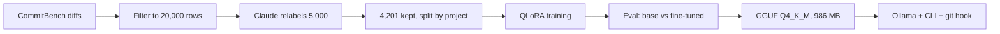

# CommitCraft

[](https://github.com/shivankarpatra04/CommitCraft/actions/workflows/ci.yml)
[](LICENSE)
[](https://huggingface.co/Shivankar04/commitcraft-qwen-1.5b-lora)

CommitCraft turns a `git diff` into a one-line [Conventional Commit](https://www.conventionalcommits.org/)
message, using Qwen2.5-Coder 1.5B fine-tuned with QLoRA. It runs on your own computer with Ollama, so your code
stays there.

## The problem

Good commit messages take effort, so they often end up as `fix stuff`. Hosted AI tools can write them, but they
send your code to a server, and that is not always allowed. The small base model can run locally, but it wraps
its answer in markdown and adds explanations, so its output cannot be used as a commit message. CommitCraft is a
fine-tune for this one job, small enough for a laptop.

## Quickstart

Install [Git](https://git-scm.com/downloads), [Ollama](https://ollama.com/download) and
[uv](https://docs.astral.sh/uv/getting-started/installation/). Then:

```bash
uv tool install git+https://github.com/shivankarpatra04/CommitCraft
commitcraft setup          # Once. Downloads a model of about 1 GB.

git add .
commitcraft commit         # Accept, edit or retry the message.
```

New to the terminal? [docs/GUIDE.md](docs/GUIDE.md) covers each step and common errors.

| Command | What it does |
| --- | --- |
| `commitcraft setup` | Downloads the model and adds it to Ollama |
| `commitcraft suggest` | Prints a message for the staged changes |
| `commitcraft commit` | Suggests a message, then commits it after you accept, edit or retry |
| `commitcraft install-hook` | Fills the message on a plain `git commit`. Skips `-m`, merges and amends |

To try the web demo locally, clone this repo, run `uv run --extra demo python -m app.space`, and open
http://localhost:7860.

## Results

200 unseen test rows from projects not used in training, greedy, at most 40 new tokens, on a Kaggle T4. Claude
Haiku judged each pair without knowing which model wrote which message, in a random order.

| Metric | A: base model | B: CommitCraft |
| --- | --- | --- |
| Format compliance | 0.0% | 95.5% |
| Correct type | 0.0% | 79.0% |
| ROUGE-L | 0.174 | 0.492 |
| Judge score (1-5) | 1.59 | 4.16 |
| Average latency (GPU) | 2.88 s | 1.60 s |

B won 195 of the 199 judged pairs, A won 1, and 3 were ties.

These numbers need context:

- The format and type checks read raw output. The base model opens with a markdown fence, so it scores 0% even
  when a good message follows. The prompt gives no format rules either. The fair claim is that B gives a line you
  can use as is, not that A cannot understand the code.
- Claude wrote the training labels and also judged, so the judge may favour that style.
- The 40-token limit cuts off A's long replies. B's lower latency comes from stopping earlier.
- These results are from the 4-bit model with the adapter, not the GGUF. A 20-row check of the GGUF through Ollama
  passed format on 20 of 20 and matched the label's type on 13 of 20, which is too few rows for a firm comparison.

### Examples

These have the largest judge-score gaps in B's favour, so they are not typical.

| A: base model (cut to fit) | B: CommitCraft | Label |
| --- | --- | --- |
| ` ```markdown fix(config/android): add function to find Android app folder This commit adds a new function...` | `docs(config): add jsdoc comment to findAndroidAppFolder` | `docs(config): add jsdoc comments to findAndroidAppFolder` |
| ` ```markdown Fix JSON array closing brace offset calculation This commit addresses an issue...` | `fix(utils): stop reading past buffer size in closing brace lookup` | `fix(utils): bound closing brace search to buffer size` |
| ` ```markdown Fix: Update dependency 'js-yaml' to version 3.13.1 This commit updates...` | `style(yml): use var instead of const and remove trailing whitespace` | `refactor(lib): use var instead of let and const in yml parser` |

The judge gave B full marks in the last row, yet its type differs from the label.

## How it works



Training uses 4-bit nf4 weights and LoRA (r=16, alpha=32) for 2 epochs. Only the commit message counts toward the
loss. See the [model card](https://huggingface.co/Shivankar04/commitcraft-qwen-1.5b-lora) for all settings.

## Reproduce training

You need accounts on Hugging Face, Anthropic, Weights & Biases and Kaggle. Copy `.env.example` to `.env` and fill it in.

```bash
uv sync
uv run python -m data.prepare             # Filter CommitBench to 20,000 rows
uv run python -m data.relabel --limit 50  # Test on 50 rows and print a cost estimate
uv run python -m data.relabel --batch     # Relabel 5,000 rows. This cost $0.38
uv run python -m data.publish --push      # Split by project and upload to your account
```

Then, on Kaggle:

1. Run [notebooks/kaggle_train.ipynb](notebooks/kaggle_train.ipynb) on a T4 GPU. Training took 48 minutes. Its last
   cells run the evaluation, which needs the `ANTHROPIC_API_KEY` secret.
2. Run [notebooks/kaggle_export.ipynb](notebooks/kaggle_export.ipynb) with no GPU to build and upload the GGUF.

Tests need no GPU, network or API key: `uv run pytest` and `uv run ruff check .`

## Project structure

```text
config.py        All settings and the one shared prompt
data/            Filter, relabel with Claude, split and publish
train/           QLoRA training, adapter merge and GGUF upload
eval/            Generate, judge and report
app/             CLI with git hook, and the Gradio demo
scripts/         GGUF export and the model card and Space upload
spaces/          Files for an optional Hugging Face Space
notebooks/       Kaggle training, evaluation and export
docs/            Beginner guide, model card and interview notes
tests/           Run on CPU with everything external mocked
Modelfile        Ollama model definition
```

## Limitations

- **Small diffs only.** It was trained and tested on diffs of at most 4,000 characters and 3 files. It reads the first
  2,400 characters, so expect weaker results on big changes.
- **Rare types are weak.** `fix` is about half of the labels, and `ci` has only 1 in the labeled data.
- **It can be wrong.** It can state wrong details, or choose a different type or scope from a person. Read the message
  before you accept it.
- **Subject line only.** It writes no commit body.
- **Input differs slightly from training.** Training diffs hide numbers as `<I>`, while real diffs have real numbers.
- **No hosted demo.** Hugging Face requires a paid plan for a Gradio Space on free CPU. The files are in `spaces/`.

## License and credit

- Code: [MIT](LICENSE).
- Model and dataset: CC BY-NC 4.0, non-commercial use only, because the training data has that license.
- Data: [CommitBench](https://huggingface.co/datasets/Maxscha/commitbench) (CC BY-NC 4.0). Claude Haiku rewrote the
  messages.
- Base model: [Qwen2.5-Coder-1.5B-Instruct](https://huggingface.co/Qwen/Qwen2.5-Coder-1.5B-Instruct) (Apache-2.0).
